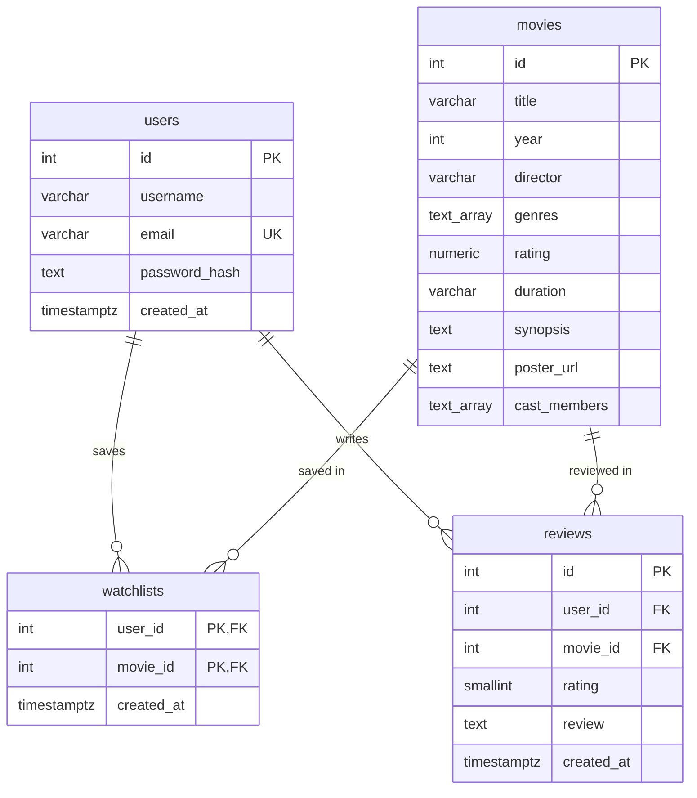

# FilmLog API

Backend assignment GDGoC. REST API movie watchlist dengan login JWT, review, dan rekomendasi Gemini (dari database). Detail endpoint: [api.md](api.md).

- Deploy: https://gcgocsaiph.vercel.app
- Postman collection: https://documenter.getpostman.com/view/60024070/2sBYHYuHr7
- Video: https://drive.google.com/file/d/10txcBXKvKuh0PhCWwlMBaFSqQxA-ktsN/view?usp=sharing (diakhir ngeblank dikit ga ngaruh)

| Component  | Technology                  |
| ---------- | --------------------------- |
| Runtime    | Node.js 22.9+, Express 5    |
| Database   | PostgreSQL via `pg`         |
| Auth       | `bcrypt`, `jsonwebtoken`    |
| AI         | Gemini, via `@google/genai` |
| Rate limit | `express-rate-limit`        |
| Migrations | Supabase CLI                |

## File structure

```text
frontend/               UI starter (index.html, app.js), static
└── data/movies.json    fallback app.js, 20 film
backend/
├── src/
│   ├── server.js       app Express: middleware, route, call Gemini
│   ├── utils.js        save semua query SQL jadi function
│   └── db.js           connection pool Postgres
├── supabase/
│   ├── config.toml     config file seed
│   ├── migrations/     schema filmsuki
│   └── seed.sql        INSERT 20 film
├── package.json
└── .env.example        template environment variable
vercel.json             service frontend + backend Vercel
```

## How it runs

### Quick start

Jalankan perintah dari folder `backend/` dengan Node.js 22.9+ dan npm.

1. Install dependency dengan `npm ci`.
2. Copy `.env.example` menjadi `.env` jika belum ada, lalu isi `DATABASE_URL`, `JWT_SECRET`, dan `GEMINI_API_KEY`.
3. Run migration dan seed:

    ```bash
    npm run db:push -- -- --include-seed
    ```

4. Run `npm run dev`, lalu buka `http://localhost:3000`. Kalau mau tidak pakai watch mode, run `npm start`.

Command `db:push` akan ngepush ke database di env `DATABASE_URL`.

### Request lifecycle

1. `express.json()` parse body JSON.
2. `express.static("../frontend")` menyajikan UI kalau path-nya cocok dengan sebuah file. Ini hanya terpakai saat server jalan lokal dari `backend/`; di Vercel, request nonAPI tidak sampai ke Express (lihat [Deploy to Vercel](#deploy-to-vercel)).
3. `authenticateToken` di `/api/watchlist`, `/api/watched`, dan `/api/movies/recommend`. Middleware untuk verifikasi JWT dan menaruh payloadnya di `req.user`.
4. Rate limiter jalan di `/api/movies/recommend`, dihitung per `req.user.id`.
5. Handler route validasi input, memanggil fungsi dari `utils.js`, lalu mengubah hasil atau error-nya menjadi status code.

| Script            | Behavior                                                                                                                                               |
| ----------------- | ------------------------------------------------------------------------------------------------------------------------------------------------------ |
| `npm run dev`     | Run server dengan `node --watch`                                                                                                                       |
| `npm start`       | Run server                                                                                                                                             |
| `npm run db:push` | Push migration ke `DATABASE_URL` via Supabase CLI, setelah `dotenv-cli` keload `.env`. Dengan `-- -- --include-seed`, `supabase/seed.sql` ikut di run. |

### Environment variables

| Variable         | Purpose                                                              |
| ---------------- | -------------------------------------------------------------------- |
| `DATABASE_URL`   | Connection string Postgres. Required!!.                              |
| `JWT_SECRET`     | Secret signature token, default hardcoded `sigmaboi`; ganti sendiri. |
| `EXP_TIME`       | Exp token, default `1h`. Contoh lain: `30m` / `2h`.                  |
| `GEMINI_API_KEY` | API key untuk client Gemini.                                         |
| `GEMINI_MODEL`   | Nama model, default `gemini-3.1-flash-lite`                          |
| `PORT`           | Port HTTP, default `3000`                                            |

### Verification

Setelah server berjalan, periksa katalog:

```bash
curl -i 'http://localhost:3000/api/movies?genre=Sci-Fi&search=Inception'
```

Expected response: `200` dengan array film. contoh request [API reference](api.md) untuk register, login, dan endpoint **auth**.

## Deploy to Vercel

Deploy: 1 project Vercel dengan 2 service, lengkapnya di `vercel.json`:

| Service    | Root        | Hasil build                                         |
| ---------- | ----------- | --------------------------------------------------- |
| `frontend` | `frontend/` | Static file CDN: `index.html`, `app.js`, `data/`    |
| `backend`  | `backend/`  | Vercel Function Express, entrypoint `src/server.js` |

### Steps

1. Import repo di dashboard Vercel, atau run `vercel link` dari **root** repo.
2. Isi environment variable di Project Settings -> Environment Variables, atau via CLI dari root repo :

    ```bash
    vercel env add DATABASE_URL
    vercel env add JWT_SECRET
    vercel env add GEMINI_API_KEY
    ```

    `EXP_TIME` dan `GEMINI_MODEL` optional, value defaultnya mengikuti [Environment variables](#environment-variables). Tanpa `JWT_SECRET`, token default memiliki signature `sigmaboi`.

    `DATABASE_URL` di Vercel tidak bisa memakai `sslrootcert=supabase/ca.crt`, karena `ca.crt` tidak ikut masuk bundle function dan setiap query gagal dengan `ENOENT`. Di Vercel, value-nya memakai `sslmode=require&uselibpqcompat=true` tanpa `sslrootcert`: koneksi tetap terenkripsi, tapi sertifikat Supabase tidak diverifikasi.

3. Jalankan migration dari `backend/`.

    ```bash
    cd backend
    npm run db:push -- -- --include-seed
    ```

4. Deploy dari root repo:

    ```bash
    vercel          # preview deployment
    vercel --prod   # production deployment
    ```

    Dengan Git integration, push ke branch production (`main`) membuat production deployment, dan push ke branch lain membuat preview.

5. Cek katalog di domain hasil deploy:

    ```bash
    curl -i 'https://<domain>/api/movies?genre=Sci-Fi'
    ```

`vercel dev` tidak dipakai untuk local development karena service `frontend` adalah static files tanpa framework.

## Database

Schema lengkapnya: [migration](backend/supabase/migrations/20261105153013_schema.sql).



- `watchlists` tidak punya column `id` sendiri. Primary key-nya `(user_id, movie_id)`, satu film cuman bisa muncul sekali di watchlist 1 user.
- `reviews` juga jadi log watched. `UNIQUE (user_id, movie_id)` membatasi satu review per film per user, dan POST kedua memperbarui row yang sama.
- Email unique case insensitive, via index di `lower(email)`.
- Menghapus user juga menghapus watchlist dan review miliknya (`ON DELETE CASCADE`).
- CHECK constraint: rating review 1–5, rating katalog 0–10, field username, title, director, dan review tidak boleh hanya berisi whitespace.
- Semua tabel ada di schema `filmsuki`, dan akses `PUBLIC` ke schema itu dicabut. Backend memakai koneksi `pg` dengan role pada `DATABASE_URL`. Auth dikelola oleh aplikasi sendiri; migration ini tidak menambahkan RLS policy dan konfigurasi lokal menonaktifkan Supabase Data API. Pemisahan data user dilakukan lewat filter query backend.

| Index                                       | Purpose                                   |
| ------------------------------------------- | ----------------------------------------- |
| GIN di `movies(genres)`                     | Filter `?genre=` (`genres @> ARRAY[...]`) |
| `watchlists(movie_id)`, `reviews(movie_id)` | Lookup foreign key dari sisi film         |
| `reviews(user_id, created_at DESC)`         | Riwayat tontonan user, dari yang terbaru  |
| Unique di `users(lower(email))`             | Login dan pengecekan email duplikat       |

## Security and error handling

Password dihash dengan `bcrypt.hash(password, 10)` di handler register, lalu dicek dengan `bcrypt.compare` di handler login. Hash tidak pernah keluar dari server.

Saat register dan login, server ngisi signature JWT yang berisi `id` dan `email` user. `authenticateToken` di `server.js` verifikasi token di setiap protected route.

ID user selalu diambil dari token yang sudah diverifikasi, tidak pernah dari body request. Semua query watchlist dan review di `utils.js` filter berdasarkan ID, termasuk DELETE (user tidak bisa membaca atau menghapus data user lain).

Semua query mengirim value sebagai parameter (`$1`, `$2`, dst), sehingga input dari request tidak pernah menjadi string SQL.

Validasi input di handler:

- Register dan login: `email` harus berupa string non-blank; `password` harus berupa string dengan panjang lebih dari nol dan tidak di-trim.
- `POST /api/watchlist`: `movieId` harus integer positif.
- `POST /api/watched`: `movieId` harus integer positif, `rating` integer 1–5, dan `review` string yang tidak kosong.
- `POST /api/movies/recommend`: `prompt` harus berupa string yang tidak kosong.

`/api/movies/recommend` limit 5 request per menit per user.

Frontend menyimpan token di `localStorage`. Frontend menampilkan teks review dan alasan dari Gemini lewat `textContent`, bukan `innerHTML`, sehingga HTML di dalamnya tampil sebagai teks (agar tidak kena xss + jail breaker ai).

| Status Code | Condition                                                                                                                      |
| ----------- | ------------------------------------------------------------------------------------------------------------------------------ |
| `400`       | Input tidak valid, email sudah terdaftar, atau film sudah ada di watchlist                                                     |
| `401`       | Token tidak dikirim, atau email/password salah                                                                                 |
| `403`       | Token tidak valid atau sudah kedaluwarsa                                                                                       |
| `404`       | Film tidak ditemukan, film tidak ada di watchlist saat DELETE, atau watchlist/review ke film yang tidak ada (FK error `23503`) |
| `429`       | Batas rate limit                                                                                                               |
| `502`       | Gemini mengembalikan ID yang tidak ada di katalog                                                                              |
| `500`       | Error database atau Gemini lainnya                                                                                             |
